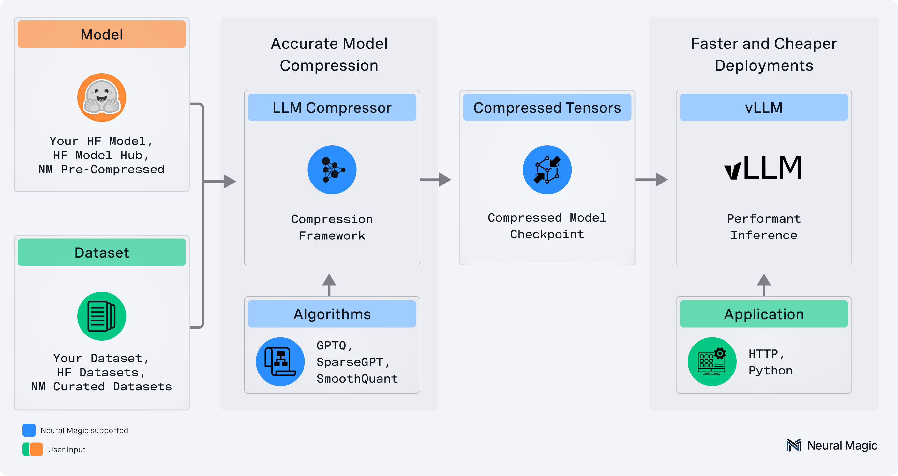

# What is LLM Compressor?

**LLM Compressor** is an easy-to-use library for optimizing large language models for deployment with vLLM. It provides a comprehensive toolkit for applying state-of-the-art compression algorithms to reduce model size, lower hardware requirements, and improve inference performance.

   

## Which challenges does LLM Compressor address?

Model optimization through quantization and pruning addresses the key challenges of deploying AI at scale:

| Challenge | How LLM Compressor helps |
|-----------|--------------------------|
| GPU and infrastructure costs | Reduces memory requirements by 50-75%, enabling deployment on fewer GPUs |
| Response latency | Reduces data movement overhead because quantized weights load faster |
| Request throughput | Utilizes lower-precision tensor cores for faster computation |
| Energy consumption | Smaller models consume less power during inference |

For more information, see [Why use LLM Compressor?](./steps/why-llmcompressor.md)

## New in this release

Review the [LLM Compressor v0.15.0 release notes](https://github.com/vllm-project/llm-compressor/releases/tag/0.15.0) for details about new features. New features to be aware of include:

- **HIGGS mixed-precision quantization**: HIGGS collects layer-wise MSE sensitivity data and formulates an integer linear program to select an optimal mixed-precision configuration for a target average bitwidth. The resulting config can be passed to `oneshot` or `model_free_ptq`.

- **Block-wise QAD**: The new `QADModifier` runs quantization-aware distillation after a weight-quantization modifier in the same recipe. It caches calibration inputs and the unquantized subgraph output as the teacher, then trains the quantized weights through compressed-tensors fake quantization, without loading a separate teacher model.

- **Layerwise compression and sequential offloading**: The sequential pipeline can decompress and compress one layer at a time, avoiding upfront whole-model conversion for large checkpoints. Onload/offload is managed manually with optional CPU staging and pinned memory via `stage_weights_in_pinned_memory=True`.

- **REAP reports and non-uniform pruning**: REAP now writes per-expert saliency reports, supports calibration-only report generation with `sparsity=0.0`, and accepts per-layer non-uniform expert sparsity. `n_routed_experts` is now recorded in config names.

- **MoNe expert pruning**: MoNe collapses low-saliency experts into constant "novice" vectors instead of removing them, keeping the router at full width while reducing expert compute.

- **Faster observers for MXFP4 formats**: The MSE and iMatrix observers gained exponential grid search and magnitude normalization for MXFP4 scales, and the iMatrix observer now shares the MSE Triton kernel, with roughly 1.2-3.4x end-to-end speedups on tested models.

- **MFPTQ SpinQuant rotations**: `SpinQuantConverter` applies offline R1/R2 Hadamard rotations directly to safetensors before model-free quantization, and `model_free_ptq` now accepts converter chains.

- **MXFP6 and MXFP4xFP8 support**: Added MXFP6A8/MXFP6A16 schemes and examples, plus an MXFP4xFP8 example and refreshed quantization documentation.

- **Broader hardware and model support**: The fused GPTQ Triton kernel now runs on Intel XPU, MTP layers load through Transformers `MtpModel`, and new checkpoints and examples include Nemotron 3.5 Super VL FP8, Zyphra Zaya1, Muse Spark, and Qwen3.6 MXFP4xFP8.

- **Docs and community**: Added the Open Research Hub for community experiment results and a full Simplified Chinese README translation.

## Supported algorithms and techniques

| Algorithm | Description | Use Case |
|-----------|-------------|----------|
| **RTN** (Round-to-Nearest) | Fast baseline quantization | Quick compression with minimal setup |
| **GPTQ** | Weighted quantization with calibration | High-accuracy 4 and 8 bit weight quantization |
| **AWQ** | Activation-aware weight quantization | Preserves accuracy for important weights |
| **SmoothQuant** | Outlier handling for W8A8 | Improved activation quantization |
| **SpinQuant** | Rotation-based transforms | Improved low-bit accuracy |
| **QuIP** | Incoherence processing | Advanced quantization preprocessing |
| **REAP** | Router-weighted expert activation pruning | Reduce the memory footprint of MoE models by removing low-saliency experts |
| **FP8 KV Cache** | KV cache quantization | Long context inference on Hopper-class and newer GPUs |
| **AutoRound** | Optimizes rounding and clipping ranges via sign-gradient descent | Broad compatibility |

Trying something that is not listed here, such as a new algorithm or an
unusual combination of techniques? The [Open Research Hub](./research/index.md)
collects community field reports on exactly that, and it accepts submissions by
pull request.

## Supported quantization schemes

LLM Compressor supports applying multiple formats in a given model.

| Format | Targets | Compute Capability | Use Case |
|--------|---------|-------------------|----------|
| **W4A16/W8A16** | Weights | 7.5 (Turing and up) | Optimize for latency on older hardware |
| **W8A8-INT8** | Weights and activations | 7.5 (Turing and up) | Balanced performance and compatibility |
| **W8A8-FP8** | Weights and activations | 8.9 (Ada Lovelace and up) | High throughput on modern GPUs |
| **MXFP8** | Weights and activations | 10.0 (Blackwell) | Microscale FP8 |
| **NVFP4** | Weights and activations | 10.0 (Blackwell) | Maximum compression on latest hardware |
| **MXFP4** | Weights and activations | 10.0 (Blackwell) | Maximum compression; MoE experts also run on 9.0 (Hopper) with 16-bit activations |
| **MXFP4xFP8** | Weights and activations | 9.0 (Hopper and up) | MXFP4 weights with dynamic FP8 activations, typically for MoE experts |
| **NVFP4A16/MXFP4A16/MXFP8A16** | Weights | 7.5 (Turing and up) | Weight-only microscale compression |
| **W4AFP8** | Weights and activations  | 9.0 (Hopper and up) | Low-bit weights with dynamic FP8 activations |
| **W4AINT8** | Weights and activations  | — (Arm CPU) | Low-bit weights with dynamic INT8 activations |

!!! warning
    Sparse compression (including 2of4 sparsity) is no longer supported by LLM Compressor due to lack of hardware support and user interest. Please see https://github.com/vllm-project/vllm/pull/36799 for more information.
